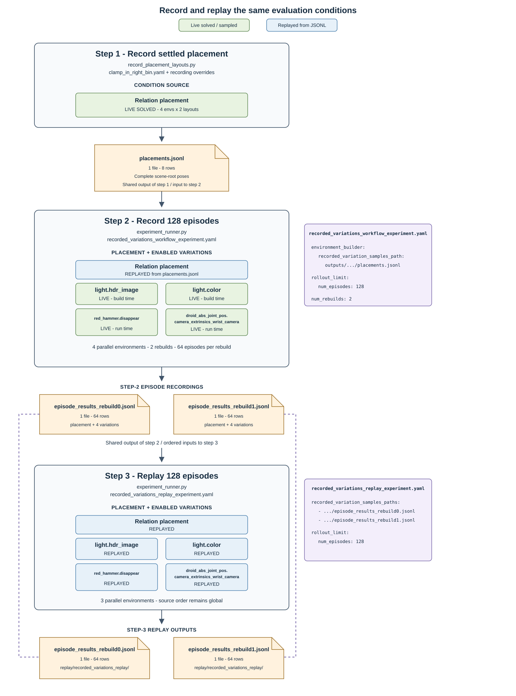

Run an Evaluation with Recorded Variations
==========================================

Recorded variations let an evaluation reproduce the same placement, lighting,
object-presence, and camera conditions with a different number of parallel
environments. This workflow uses the ``clamp_in_right_bin`` graph environment,
whose standard episode timeout is 70 seconds, and the local zero-action policy.

The workflow has three stages:

1. record eight settled placement layouts;
2. run 128 episodes across two rebuilds while recording all enabled variations;
3. replay the two 64-row recordings in three environments and match each variation
   payload to its indexed source row.

The generated JSONL files stay below ``outputs/recorded_variations_workflow``
and are not source files.

      replays placement while recording four live-sampled variations into two
      64-row JSONL files, then replays all five conditions in three parallel
      environments and verifies each replay payload against its indexed source row.

Record Settled Placement Layouts
--------------------------------

From the repository root, record eight layouts that pass the configured
post-physics checks:

.. code-block:: bash

   python isaaclab_arena/scripts/record_placement_layouts.py \
     env_spec=isaaclab_arena_environments/robolab/tasks/clamp_in_right_bin.yaml \
     output=outputs/recorded_variations_workflow/placements.jsonl \
     num_envs=4 env_spacing=2 layouts_per_env=2 \
     min_layouts=8 max_batches=5 seed=42 presets=physx \
     settle.num_steps=120 \
     settle.validators.pose_shift.max_translation_m=0.015 \
     --device cuda:0

The verified run accepted all eight requested layouts. Each output row records
the complete scene-root poses under the top-level ``placement`` key.

Record a 128-Episode Evaluation
-------------------------------

.. note::

   To make steps 2 and 3 complete faster, temporarily edit
   ``isaaclab_arena_environments/robolab/tasks/clamp_in_right_bin.yaml`` and
   change ``episode_length_s`` from ``70.0`` to ``1.0``. Keep the one-second
   timeout through both recording and replay.

The maintained Experiment Definition configures four parallel environments,
the zero-action policy, two rebuilds, and 128 total episodes. Both rebuilds
load the eight-row placement recording through
``environment_builder.recorded_variation_samples_path``; the replay scheduler
wraps as needed.
The total budget is split evenly, so each rebuild records 64 episodes:

.. literalinclude:: ../../../../isaaclab_arena_environments/experiment_configs/placement_record_replay/recorded_variations_workflow_experiment.yaml
   :language: yaml

It enables two build-time variations:

* ``light.hdr_image``
* ``light.color``

It also enables two run-time variations:

* ``red_hammer.disappear`` for a distractor that is not part of the task;
* ``droid_abs_joint_pos.camera_extrinsics_wrist_camera``.

The placement recording supplies the scene-level relation-placement samples.
Other enabled variations are sampled live and recorded in each episode result.

Run the Experiment:

.. code-block:: bash

   python isaaclab_arena/evaluation/experiment_runner.py \
     --experiment_config \
       isaaclab_arena_environments/experiment_configs/placement_record_replay/recorded_variations_workflow_experiment.yaml \
     --viz none \
     --experiment_output_directory \
       outputs/recorded_variations_workflow/record

The canonical recordings are written to:

.. code-block:: text

   outputs/recorded_variations_workflow/record/recorded_variations/episode_results_rebuild0.jsonl
   outputs/recorded_variations_workflow/record/recorded_variations/episode_results_rebuild1.jsonl

A complete run writes exactly 64 rows to each file, for 128 episodes total.
Zero action does not solve the task; task failure is expected and does not
indicate an execution failure.

Replay with Three Parallel Environments
----------------------------------------

The replay Experiment Definition lists the two step-2 episode recordings,
configures three parallel environments, and runs 128 total episodes. The
two-file replay list supplies one file per rebuild, so each rebuild replays
all 64 rows:

.. literalinclude:: ../../../../isaaclab_arena_environments/experiment_configs/placement_record_replay/recorded_variations_replay_experiment.yaml
   :language: yaml

Run the replay:

.. code-block:: bash

   python isaaclab_arena/evaluation/experiment_runner.py \
     --experiment_config \
       isaaclab_arena_environments/experiment_configs/placement_record_replay/recorded_variations_replay_experiment.yaml \
     --viz none \
     --experiment_output_directory \
       outputs/recorded_variations_workflow/replay

Verify the episode count, source-index coverage, and variation payloads:

.. code-block:: bash

   python - <<'PY'
   import json
   from pathlib import Path

   root = Path("outputs/recorded_variations_workflow")
   for rebuild_index in range(2):
       filename = f"episode_results_rebuild{rebuild_index}.jsonl"
       source_path = root / "record/recorded_variations" / filename
       replay_path = root / "replay/recorded_variations_replay" / filename
       source = [json.loads(line) for line in source_path.read_text().splitlines()]
       replay = [json.loads(line) for line in replay_path.read_text().splitlines()]

       assert len(source) == len(replay) == 64
       source_indices = [row["replay_source_record_index"] for row in replay]
       assert sorted(source_indices) == list(range(len(source)))
       for replay_row in replay:
           index = replay_row["replay_source_record_index"]
           source_row = source[index]
           assert replay_row["placement"] == source_row["placement"]
           assert replay_row["variations"] == source_row["variations"]
   print("Matched all 128 recorded placement and variation rows.")
   PY

A complete replay writes exactly 64 rows per rebuild. Every replayed row's
``placement`` and ``variations`` mappings should exactly match the corresponding
indexed source row. The ``replay_source_record_index`` values should collectively
cover every source row exactly once; their output order may differ. Episode metadata
such as ``env_id`` and ``timestamp`` can differ because the replay uses a different
parallelization.

The matching replay payload contains:

* the relation-placement scene-root poses under ``placement``;
* HDR selection, light color, red-hammer presence, and wrist-camera extrinsics
  under ``variations``.

This verifies that recorded variation order is independent of the number of
parallel simulation environments.

.. note::

   After completing the workflow, discard the temporary timeout edit by
   restoring ``episode_length_s`` in
   ``isaaclab_arena_environments/robolab/tasks/clamp_in_right_bin.yaml`` to
   ``70.0``. The one-second timeout is only for this sample workflow and should
   not be retained for normal evaluations.
