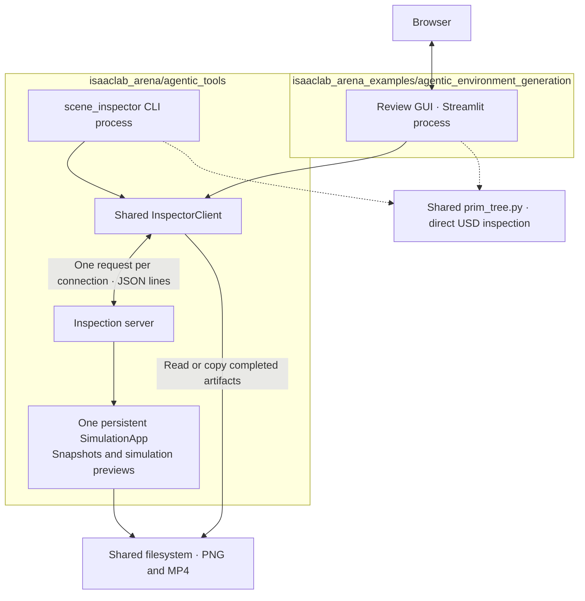

# Shared inspection service for the review GUI and scene inspector

Status: implemented; validation is recorded in the accompanying tests.
Date: 2026-11-08.

## Objective

Keep one persistent SimulationApp backend usable by both the review GUI and
`scene_inspector.py`, while reducing connection management, serialization, and
artifact-handling code in the frontends. Preserve the current rendering and
preview capabilities and existing CLI commands.

The inspector scripts and their inspection-specific dependencies belong in
`isaaclab_arena/agentic_tools/`. The review GUI and its GUI-only dependencies remain
in `isaaclab_arena_examples/agentic_environment_generation/`. Dependencies flow
from the example GUI into the core tools package; the tools must not import the
examples package or require Streamlit.

The backend remains a local service using a Unix socket and shared filesystem.
Simulation operations run sequentially on the process's main thread. Direct USD
prim-tree inspection continues to use `isaaclab_arena.utils.usd.prim_tree` without
starting or contacting SimulationApp.

## Current design and sources of complexity

| Current behavior | Proposed change |
| --- | --- |
| The inspector scripts live in examples and import the client and server from `review_gui.simapp`. | Move the scripts into `isaaclab_arena/agentic_tools` and shared implementation into its `inspection` subpackage. |
| `scene_inspector_backend.py` invokes the server's private `_serve_socket()`. | Provide one public `serve()` function for backend entrypoints. |
| A client holds a connection; the server serves that connection until disconnect. | Open and close a connection for each request. |
| Streamlit stores a client in session state and must release it to unblock other tabs. | Keep only backend configuration and presentation results in session state. |
| Snapshots accept a graph spec; previews accept YAML text. | Accept a graph spec in both client methods and send its JSON-compatible mapping. |
| The client reads PNG bytes, but preview callers copy/read MP4 files and delete directories. | Return artifact paths consistently and share consumption/cleanup helpers. |
| GUI and CLI select sockets and manage process lifetime differently. | Share address selection and make attached versus privately owned backends explicit. |

Relevant current implementation:

- [CLI](../../isaaclab_arena/agentic_tools/scene_inspector.py) and [standalone backend launcher](../../isaaclab_arena/agentic_tools/scene_inspector_backend.py).
- [GUI launcher](gui_runner.py) and [Streamlit connector](review_gui/simapp_connector.py).
- [Socket client](../../isaaclab_arena/agentic_tools/inspection/client.py) and [server](../../isaaclab_arena/agentic_tools/inspection/server.py).
- [Snapshot renderer](../../isaaclab_arena/agentic_tools/inspection/thumbnail_capture.py) and
  [preview runner](../../isaaclab_arena/agentic_tools/inspection/sim_preview.py).

## Proposed architecture



The browser continues to communicate with Streamlit. The Python Streamlit process
is the IPC client; the browser does not access the Unix socket or backend files.
Both Python frontends must see the same filesystem paths as the backend, as they
do when running inside the same clone's container.

The diagram's groups show code ownership. `InspectorClient` runs inside each
frontend process; moving it into the core package does not add another process.

Proposed layout from the repository root:

```text
isaaclab_arena/
    agentic_tools/
        __init__.py                  # No eager imports.
        scene_inspector.py           # CLI arguments and report formatting.
        scene_inspector_backend.py   # Calls inspection.server.serve().
        inspection/
            __init__.py              # No eager imports.
            client.py                # Stateless requests and error handling.
            protocol.py              # Request/result schemas and validation.
            server.py                # Public serve(); sequential dispatch.
            backend_process.py       # Socket selection and process lifecycle.
            artifacts.py             # Read/copy outputs and temporary cleanup.
            boot.py                  # SimulationApp startup.
            thumbnail_capture.py     # Snapshot orchestration.
            sim_preview.py           # Preview execution and recorder.
            asset_usd.py             # USD paths, dimensions, and cache keys.
            asset_identifiers.py     # Shared object-set member identifiers.
            object_reference_paths.py
            kit_viewport.py
            camera_framing.py
            axis_overlay.py
        object_control_runner.py     # Existing tool; unchanged by this move.
        object_control/              # Existing implementation; unchanged.
    utils/usd/prim_tree.py            # Existing shared USD utility; reused.
isaaclab_arena_examples/
    agentic_environment_generation/
        gui_runner.py                # GUI launcher using core lifecycle helpers.
        review_gui/
            simapp_connector.py      # Streamlit-specific integration only.
            visualization_service.py # GUI cards and presentation caching.
            spec_visualization/      # GUI card models and rendering.
            ...                      # Editor, UI state, and other GUI-only code.
```

Move rendering helpers without rewriting their algorithms during the extraction.
Remove reverse dependencies on GUI presentation modules, including the current
snapshot renderer's import of `object_set_member_key` from `asset_cards.py`.
Move that identifier helper to `agentic_tools/inspection/asset_identifiers.py`
and have both the renderer and GUI import it there. Keep card models, editor
validation presentation, Streamlit state, and placeholder/error UI in examples.

Existing core dependencies such as graph-spec loading, `spec_io`, the USD
prim-tree utility, and placement geometry visualization stay in their existing
`isaaclab_arena` modules. Reuse them rather than moving or copying unrelated core
code into `agentic_tools`. Move any remaining inspector-specific helper currently
in examples into the core tools package before migrating its caller.

The new canonical entrypoints are:

```bash
isaaclab.sh -p -m isaaclab_arena.agentic_tools.scene_inspector_backend
isaaclab.sh -p -m isaaclab_arena.agentic_tools.scene_inspector prim-tree --usd /path/to/scene.usd --output tree.txt
```

These commands run inside the clone's Docker container. Update GUI subprocess
launches, tests, documentation, and skill examples to use the core module paths.
The old example inspector scripts are removed after their callers migrate; GUI
entrypoints remain in examples. Preserve inspector subcommands, flags, and output
contracts while changing the script/module locations.

Client, protocol, and lifecycle imports must not initialize Kit or SimulationApp.
Continue deferring Kit-dependent imports until after the server boots the app.

## High-level Python API

These signatures describe the contract, not a requirement to add a class for
every request. Small typed mappings are sufficient for protocol data.

The public API lives under `isaaclab_arena.agentic_tools.inspection`: client
methods in `client.py`, result schemas in `protocol.py`, file helpers in
`artifacts.py`, process helpers in `backend_process.py`, and `serve()` in
`server.py`. Frontends import these modules directly; `__init__.py` remains free
of eager imports or re-exports.

```python
class InspectorClient:
    def __init__(
        self,
        socket_path: Path,
        *,
        connect_timeout_s: float,
        request_timeout_s: float,
    ) -> None: ...

    def render_spec(
        self,
        spec: ArenaEnvGraphSpec,
        *,
        background_panorama: bool = False,
        ignore_cache: bool = False,
    ) -> InspectionResult: ...

    def run_sim_preview(
        self,
        spec: ArenaEnvGraphSpec,
        *,
        num_envs: int,
        num_steps: int,
        env_spacing: float,
        show_placement_overlay: bool = False,
    ) -> InspectionResult: ...

    def ping(self, *, timeout_s: float) -> None: ...

    def shutdown(self, *, timeout_s: float) -> None: ...


class Artifact(TypedDict):
    path: str
    media_type: str


class InspectionResult(TypedDict):
    artifacts: dict[str, Artifact]
    metadata: dict[str, Any]
    warnings: list[str]
    temporary_dir: str | None


def serve(socket_path: Path) -> int: ...

def select_socket_path(explicit: Path | None = None) -> Path: ...

def spawn_backend(socket_path: Path) -> subprocess.Popen: ...

def wait_for_backend(
    process: subprocess.Popen, socket_path: Path, *, timeout_s: float
) -> None: ...

def stop_owned_backend(process: subprocess.Popen, socket_path: Path) -> None: ...

def consume_result(result: InspectionResult) -> ContextManager[InspectionResult]: ...

def read_artifact(result: InspectionResult, artifact_id: str) -> bytes: ...

def copy_artifact(
    result: InspectionResult, artifact_id: str, destination: Path
) -> Path: ...
```

Each client method opens a socket, sends one request, reads one response, and closes
the socket in `finally`. There is no public `connect()`/`disconnect()` lifecycle.
Failures raise one shared `InspectionError` containing the backend error message
and optional traceback. `ping()` succeeds or raises; it does not hide a timeout
as a definitive assertion that the backend is dead.

Timeouts are finite and configurable. Rendering and preview deadlines should be
longer than health-check deadlines and calibrated against existing workloads.
A request timeout means the outcome is unknown: work may still finish on the
server. Do not automatically retry previews or fresh captures.

`consume_result()` releases only the result's owned temporary directory on exit,
including when reading or copying fails. It never deletes cached artifacts or
caller-selected output paths. Temporary paths must be validated as belonging to
the preview-output root before recursive deletion.

Example usage after loading a spec with its includes expanded:

```python
from isaaclab_arena.agentic_tools.inspection.artifacts import consume_result, copy_artifact, read_artifact
from isaaclab_arena.agentic_tools.inspection.client import InspectorClient

# Both frontends construct this core client using their configured deadlines.
client = InspectorClient(
    socket_path,
    connect_timeout_s=connect_timeout_s,
    request_timeout_s=request_timeout_s,
)

# GUI: store display bytes, not a persistent socket, in Streamlit session state.
with consume_result(client.render_spec(spec)) as result:
    thumbnails = {
        node_id: read_artifact(result, node_id)
        for node_id in result["artifacts"]
    }
    dimensions = result["metadata"]["aabb_dimensions_m"]

# CLI: copy the completed preview to the requested output location.
with consume_result(
    client.run_sim_preview(spec, num_envs=2, num_steps=10, env_spacing=30.0)
) as result:
    copy_artifact(result, "preview", Path("preview.mp4"))
```

The CLI adapter preserves its existing stdout report fields even though the
internal result structure changes. GUI adapters preserve card rendering,
placeholder behavior, and error presentation.

## IPC contract

Use UTF-8 newline-delimited JSON over `AF_UNIX`/`SOCK_STREAM`: one request record
and one response record per connection. This is a small custom protocol, not
JSON-RPC 2.0. No request IDs or general dispatch framework are required for a
single outstanding request per connection.

Both render operations send a JSON-compatible graph mapping under `spec`, plus
operation-specific `options`. The examples below abbreviate the graph; actual
requests carry the complete expanded spec.

```json
{
  "cmd": "render_spec",
  "spec": {"...": "complete expanded ArenaEnvGraphSpec"},
  "options": {"background_panorama": false, "ignore_cache": true}
}
```

```json
{
  "cmd": "run_sim_preview",
  "spec": {"...": "complete expanded ArenaEnvGraphSpec"},
  "options": {
    "num_envs": 2,
    "num_steps": 10,
    "env_spacing": 30.0,
    "show_placement_overlay": true
  }
}
```

Parse YAML and expand includes at the frontend boundary using existing graph-spec
loading helpers. Preserve the current interpretation of asset paths and verify
JSON serialization of supported spec values; do not assume that every Python
value returned by `to_dict()` is already JSON-compatible. The server validates
the received mapping using the same graph model before performing work.

Successful operation responses use one envelope:

```json
{
  "ok": true,
  "result": {
    "artifacts": {
      "drawer": {
        "path": "/cache/inspection/thumbnails/capture-unique.png",
        "media_type": "image/png"
      }
    },
    "metadata": {"aabb_dimensions_m": {"drawer": [0.6, 0.4, 0.1]}},
    "warnings": [],
    "temporary_dir": null
  }
}
```

A preview uses artifact ID `preview`, media type `video/mp4`, and a unique
`temporary_dir`. Its metadata retains `env_name`, `num_envs`, `num_steps`,
`env_spacing`, and `show_placement_overlay`. Snapshot artifact IDs retain the
existing node and object-set member keys.

Failures use `{"ok": false, "error": "message", "traceback": "optional detail"}`.
`ping` and `shutdown` retain their small `{"ok": true}` acknowledgments. Validate
record structure and option types before dispatch. Log diagnostics to stderr;
socket responses and CLI stdout remain machine-readable.

Only configuration, metadata, errors, and file paths cross the socket. PNG/MP4
bytes, USD stages, live Python objects, and simulation tensors do not.

## Scheduling and backend lifetime

The server reads one complete request, executes it, writes one response, then
closes the connection. Bound the time spent waiting for an incomplete request so
an idle or disconnected client cannot hold the service indefinitely. A client
disconnect or failed response write must not terminate the whole backend.

All Kit and physics calls remain on the main thread. Use a bounded socket poll
and app updates as needed to keep Kit responsive while the server is idle.
Retain scene, recorder, physics, and registry cleanup between operations,
including after failures.

This removes idle-session starvation but does not make operations concurrent.
During a long preview, another client's request, including `ping`, waits. A ping
timeout must not cause a launcher to unlink the socket or start a replacement.
Responsive status, cancellation, and job progress would require a later queue
design; they are outside this refactor.

Socket selection uses explicit argument, then the existing
`ARENA_REVIEW_SIMAPP_SOCKET` environment variable, then the checkout-specific
default. Retain the existing variable for compatibility.

When moving the client and lifecycle modules, account for their new directory
depth in checkout discovery. Both frontends must derive the same checkout socket
key. `spawn_backend()` launches
`isaaclab_arena.agentic_tools.scene_inspector_backend` as a module.

| Mode | Startup | Shutdown ownership |
| --- | --- | --- |
| Standalone backend | `scene_inspector_backend.py` serves the selected socket. | Explicit shutdown command or process termination. |
| CLI command | Attach to the selected backend; do not auto-start one. | Close the request connection only. |
| GUI attached mode | An explicit socket or environment setting selects an existing backend. | Exiting the GUI leaves the backend running. |
| GUI private mode | With no attach setting, launch a child on a unique private socket and pass its address to Streamlit. | The GUI launcher stops only that owned child. |

Add a GUI `--socket` option for attached mode. Preserve the GUI's convenient
private-backend startup when no attach address was supplied. If an explicitly
selected backend is unavailable, report that condition instead of silently
launching a different backend.

Startup must not blindly unlink an existing socket. An address in use is an
error unless exclusive ownership and staleness are established. Initially,
reporting a stale socket for explicit cleanup is preferable to guessing from a
failed ping. Shutdown waits are bounded; terminate/kill fallback applies only to
a child process owned by the launcher.

## Artifact and cache ownership

Cached thumbnails belong to the backend. Preview directories belong to the
completed result and are released by the shared consumption helper. Failed jobs
clean incomplete outputs on the server. Outputs abandoned by a crashed client
need a documented explicit cleanup path; no automatic eviction policy is needed
for the initial refactor.

For a fresh capture, write to a unique temporary path, wait for the actual Kit
capture completion, finish overlays, and publish a unique completed artifact.
Only then return it or update the cache entry. Never treat an existing nonempty
PNG as evidence that a new asynchronous capture has completed.

A cache key may point to a newer immutable artifact after a refresh. Do not
overwrite a file already returned to another client, and do not immediately
delete the previous version while a client could still be reading it. Include
render-affecting options in the cache key. This avoids adding an artifact server
or sending large media payloads through JSON.

Preserve the current ability to display available thumbnails when individual
assets fail, but include warnings identifying failed assets. Preview execution
failures remain errors. Missing returned files are errors, not silent omissions.

## Implementation plan

| Step | Scope | Completion criteria |
| --- | --- | --- |
| 1. Move inspectors into core tools | Move both inspector scripts to `isaaclab_arena/agentic_tools` and `review_gui/simapp` implementation to `agentic_tools/inspection`; extract shared identifiers; expose `serve()`; update launchers, imports, and checkout discovery. Keep GUI-only modules in examples. | Inspector commands run through the new core module paths without importing examples or Streamlit. GUI operations keep the same protocol and outputs. Prim-tree commands still work without a backend. |
| 2. Use one request per connection | Change server dispatch and client methods together; remove stored live clients, reconnect code, and frontend disconnect calls; add bounded transport waits. | Alternating GUI/CLI requests work. Idle clients, malformed records, and disconnected readers cannot permanently block or crash the server. |
| 3. Unify operation inputs and results | Send expanded JSON spec mappings; validate schemas; return consistent artifact/metadata results; add shared consumption helpers. | Both frontends preserve existing features, stdout contracts, node IDs, and file cleanup. Includes and supported spec values survive serialization. |
| 4. Consolidate lifetime and artifact correctness | Share lifecycle helpers; add GUI attached mode; make captures publish completed immutable files; clarify cache and temporary-output ownership. | Attached GUI exit leaves the backend alive; private exit stops its child. Fresh captures cannot return an older image or race another reader. |
| 5. Validate and document | Run focused transport tests and one combined simulation smoke workflow; update CLI/GUI documentation, tests, and authoring-skill invocation examples to use the core inspector modules. | The behavior matrix below passes. Old example inspector entrypoints and the shared `review_gui/simapp` implementation are removed after all in-repo callers migrate; GUI-only code remains in examples. |

Keep each step reviewable and avoid changing the physics or rendering algorithms
while moving files. Preserve command behavior while updating the inspector
entrypoint locations. Internal protocol changes require restarting a running
backend after updating the code; mixed old/new backend versions are not a
supported compatibility target.

## Validation plan

Run package and simulation tests inside the clone's Docker container as the host
user. Run lint and formatting on the host. Reuse existing test helpers and keep
Kit-dependent imports after SimulationApp startup.

| Contract | Focused check |
| --- | --- |
| Package boundary | Core inspector scripts and dependencies have no imports from `isaaclab_arena_examples` or Streamlit. Verify GUI modules consume the core API and both new module entrypoints work in the supported runtime. |
| Checkout discovery | Moving modules does not change the selected checkout identity; GUI and CLI select the same default socket, and separate checkouts remain isolated. |
| JSON transport | Round-trip mappings, Unicode, errors, malformed input, EOF, and operation options using socket tests with fake handlers. |
| Connection fairness | Leave one accepted connection incomplete until its read deadline; verify the next valid client can then complete. Verify ordinary completed requests release the server immediately. |
| Deadlines | A blocked response times out clearly without automatic retries, socket deletion, or replacement-backend startup. |
| Spec compatibility | Compare existing YAML-loaded specs with their JSON round trip, including external includes and supported nontrivial values. |
| Artifact handling | GUI reads and CLI copies the same result; temporary outputs are removed on success/failure, cached files survive, and missing files raise a useful error. |
| Fresh capture | Perform repeated cache-bypassing captures with an observable scene/view change; verify the second result is complete and different, while the first result remains readable. |
| Backend ownership | Exiting an attached GUI leaves CLI access working; stopping a private GUI terminates only its own child; a second launcher cannot remove an active socket. |
| Simulation continuity | In one backend process, alternate snapshots and previews, exercise a handled failure, then request another snapshot successfully. |
| Existing features | Cover asset and reference thumbnails, object-set members, panorama, dimensions, cache reuse, placement overlays, multi-env preview, MP4 output, and placeholder/error presentation. |
| Direct USD path | Text/JSON prim-tree inspection works without a live backend and retains the existing metadata contracts. |

Reuse one SimulationApp process for the combined smoke workflow to limit CI
startup cost. CLI parser tests should run in child processes rather than invoking
`SystemExit` paths inside an initialized simulation test process.

The existing review findings about solver mesh extraction, static geometry's
environment origins, and camera projection should receive focused fixes/tests.
Moving the backend does not fix those algorithms. Capture freshness belongs in
the artifact-publication step above.

## Deferred extensions

An optional MCP adapter can later live under `isaaclab_arena/agentic_tools` and
reuse `inspection.client` and the shared USD utilities. It must not depend on
review GUI modules. The package move itself does not add MCP support.

Keep asynchronous jobs, cancellation, progress streaming, concurrent simulation
workers, remote HTTP transport, and binary transfer outside this change. Add a
job queue only when interactive status or cancellation during a long preview is
required; transport work can then run separately while Kit execution stays on
the main thread.
