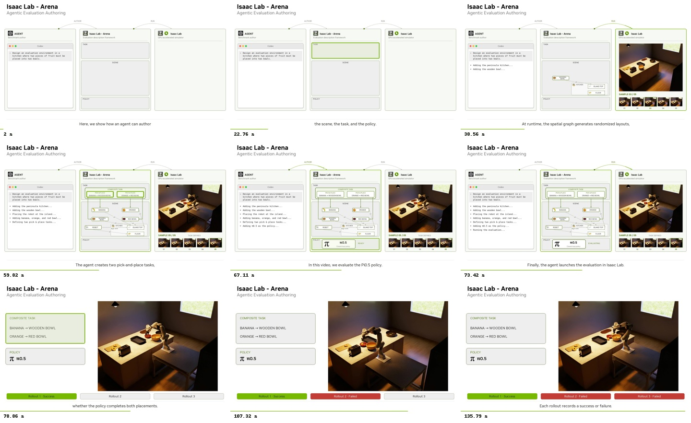

# Agentic evaluation authoring video

Source kit for the white/NVIDIA-green **Isaac Lab - Arena — Agentic Evaluation
Authoring** video: scene authoring, relation sampling, composite task authoring,
policy selection, three real policy rollouts, Kokoro narration, captions, and
synchronized highlights.

Start with [AGENT_GUIDE.md](AGENT_GUIDE.md). It contains the complete workflow,
commands, adaptation checklist, visual specification, and troubleshooting notes.
It is written for an agent that has not seen the original conversation.

```bash
# From the repository root. The destination must not already exist.
python3 tools/agentic_evaluation_video/create_project.py outputs/my_evaluation_video
```

The copied project is self-contained. Edit and run that copy; keep `template/`
as the reference example. Generated footage, evaluation results, voice audio,
downloaded fonts, and model weights are not included in Git. The small reference
asset thumbnails and logos are included, with sources in
[ASSETS.md](template/ASSETS.md).

This is an editable reference production, not a general graph-to-video engine.
The renderer and narration contain the two-fruit kitchen example's labels and
layout. The guide identifies every task-specific edit needed for another task.
Arena framework code does not need to change to reproduce the reference.

The reference was rerun on main `ec00f683c4304bdc2a496e5dc876c2934cc07ca5`:
all captures and the evaluation pipeline completed; the three policy attempts
returned success, timeout, timeout. That export was 1920×1080 at 30 fps, about
2:19, with one green and two red outcome boxes. Earlier footage had three
successful selected episodes. Neither outcome is hardcoded into this kit;
each new export uses its own recorded results. Runtime/asset versions and
stochastic inference can change trajectories, outcomes, and video duration.

The authoring transcript is a staged visualization. The simulator footage and
policy evaluations are real; the film does not record a live Codex session.



## Included code

| File in the copied project | Responsibility | Runtime |
| --- | --- | --- |
| `record.py` | Discover container, run filming phases, save logs and provenance | Host |
| `01_*.yaml` through `04_*.yaml` | Successive authoring stages, with drop clearance | Arena |
| `source_environment.yaml`, `experiment.yaml` | Complete task and evaluation settings | Arena |
| `reference_placements.jsonl`, `project.json` | Reference replay and production settings | Both |
| `capture_stages.py` | Reset/step each stage and record frames and poses | Arena |
| `film_camera.py`, `camera.json` | Editorial camera, separate from policy inputs | Arena |
| `run_filmed_experiment.py` | Factory, final-state requirements, evaluation/report | Arena |
| `render_asset_thumbnails.py` | Isolated USD renders with transparent backgrounds | Arena |
| `prepare_rollouts.py`, `summarize_evaluation.py` | Extract selected clips and verify results | Host |
| `generate_voice_over.py` | Kokoro speech and word timestamps | Host TTS venv |
| `narration.py`, `VOICE_OVER.md` | Caption phrases, visual clock, reference flashes | Host |
| `assemble_voice_over.py` | Schedule fixed-speed takes around the video | Host TTS venv |
| `edit_video.py` | Stills and MP4 rendering with one caption track | Host editing venv |
| `validate_video.py` | Encoded-media, layout, timing, and outcome checks | Host editing venv |
| `fetch_fonts.py` | Fetch and hash-check NVIDIA Sans | Host |

No Docker build files, global dependencies, policy weights, or Arena package
files are modified by these tools. Preparing a missing runtime or policy server
is a separate step, using the repository skills linked in the guide.

## Package validation

The kit was exercised from a fresh project directory containing spaces: container
discovery and a new kitchen capture, typed Experiment/replay configuration loading,
one isolated transparent asset render, verified font downloads, fresh Kokoro
narration, clip extraction, full movie rendering, and encoded-media validation.
The editing check reused existing real evaluation records and clips; it did not
rerun the three long policy attempts during packaging. Formatting, lint, Python,
JSON, and YAML checks passed. The full reference policy run is described above.
